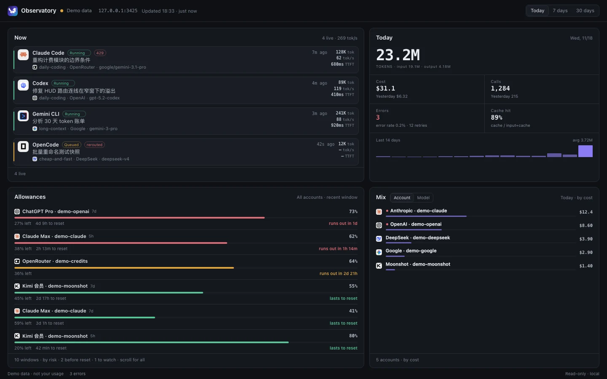

# Magpie Observatory

**One quiet screen for Magpie.** Open it and see three things: what is running
now, what today cost, and which allowance will run out before it resets.

**English** · [简体中文](README.zh-CN.md) · [Changelog](CHANGELOG.md)

[](https://www.npmjs.com/package/magpie-observatory)



<sub>The screenshot uses demo data. When the dot next to the title is amber,
the numbers are not yours.</sub>

## The three questions

| Now | Today | Allowances |
| --- | --- | --- |
| In-flight sessions, agent, actual provider and model, TTFT, tok/s, fallbacks | Tokens, cost, calls, errors, cache hit, and a 14-day sparkline | Every account's windows, sorted by risk: remaining, reset countdown, and when it runs out at the recent burn rate |

Tokens are **input + output**, the same definition Magpie's Usage page uses;
cache reads are shown separately as cache hit rate, not folded into the
headline number.

Allowance rows are per account and window, so two WorkBuddy accounts are
distinguishable. The mix card defaults to account spend; a red dot beside an
account means one of its windows runs out before it resets. Rows are red when
the window runs out before its reset or has 10% left, amber when it is tight
or has 20% left, green when it lasts, gray when there is not enough history.

The allowance card is the point. It does not stop at "73% used": it compares
the recent burn rate with the reset time. Green means it lasts until the
reset; red means it will burn out first, with an estimated time. It prefers
the last 90 minutes, falls back to the current window's average, and says
"not enough data" rather than extrapolating a 30-day window from an 18-minute
burst.

## Install

Requires a Magpie with plugin pages and page services. From npm:

```bash
magpie plugin add npm:magpie-observatory
```

or straight from GitHub:

```bash
magpie plugin add github:JohnWangggg/magpie-observatory
```

Open **Plugins → Installed → Observatory**, or the **Observatory** tab under
Plugins in the sidebar. From a local folder:

```bash
git clone https://github.com/JohnWangggg/magpie-observatory.git
magpie plugin add ./magpie-observatory
```

### One more block inside Magpie's Usage page

After install, Magpie's own **Usage** page gets a "Today" panel at the bottom:
today's tokens, cost, calls and errors against the 7-day average, plus the
top model. It reads only `usage:summary` through Magpie's native bridge; no local
service.

### If the page does not open

Magpie's plugin page is only a launcher; the dashboard is served by the local
service on `127.0.0.1:3488`. If you get a blank frame or a connection error:

1. Turn Observatory off and on in **Plugins → Installed**;
2. or run `magpie plugin off magpie-observatory && magpie plugin on magpie-observatory`;
3. check that nothing else owns 3488: `lsof -nP -iTCP:3488 -sTCP:LISTEN`.

The service now takes over a port held by the previous copy, and an older
copy steps aside for a newer one, so an update does not need a manual kill.

## How it differs from Magpie's own pages

Magpie's Routing and Usage pages are the full console: the live route stage,
per-account quota cards and charts, the request ledger, and Agent/model/account
breakdowns. Observatory does not repeat those deep views; it puts the three
things you need right now on one screen and ranks allowances across accounts.

| Question | Magpie's own pages | Observatory |
| --- | --- | --- |
| What is running, and why did it fall back? | Routing stage, most detailed | 3–4 rows with account, route group and failure code |
| What did today cost? | Usage overview, most detailed | One-screen numbers + vs yesterday/7-day average |
| Which allowance runs out first? | Quota card wall, per-card charts | **Cross-account risk ranking**, with "runs out before reset" |
| Which account is spending? | Account breakdown, lower on the page | **Top 4 accounts on the same screen** (toggle to models; a red dot means that account has a quota risk) |
| Inspect one request | Routing's recent request/replay | Not here; leave it to Magpie |

It is not a replacement for Magpie's pages. It is the first look after opening
Magpie. For the request ledger, quota charts or check-in, use Magpie's own
Usage/Routing.

## Why one screen

The previous version had 25 views, 7 style packs, levels, badges, replay,
share cards and a daily digest modal. The data was right, but opening it every
day meant learning, navigating and closing a modal. For long-term use that is
noise.

This version only puts together what Magpie's own pages keep apart:

- Magpie's Usage page has per-account quota cards and a pace forecast, but you
  scan a wall of cards. We rank every window across accounts, so the one that
  runs out first is at the top.
- Magpie's Routing page has the live stage, but seeing "in flight + today's
  spend + allowance risk" together means moving between pages.
- Deep dives (the request ledger, quota charts, check-in, latency
  distribution) stay in Magpie's own pages. They are not duplicated here.

The full feature audit, competitive research and removal list are in
[`docs/product-review-v2.md`](docs/product-review-v2.md).

## What it reads

The local service proxies only Magpie's documented read-only APIs:

| Magpie API | Used for |
| --- | --- |
| `GET /v1/magpie/trace?after=…` | in-flight and recently finished routes, tries, fallbacks |
| `GET /v1/magpie/quotas?kept=1` | account windows and reset times |
| `GET /v1/magpie/quotas/history` | the burn curve used by the forecast |
| `GET /v1/magpie/usage?period=today\|7d\|30d` | tokens, cost, calls, errors, models |
| `GET /v1/magpie/concurrency` | in-flight and queued requests |

The "Today" panel uses Magpie's native bridge and only `usage:summary`; the
main page uses the service above.

- **Read-only.** It never writes to Magpie and never calls a provider API.
- **No prompts or replies.** Only the counters and metadata needed to draw.
- **Loopback only.** The service listens on `127.0.0.1:3488` (the port is a
  plugin option).
- **Sandbox token.** The page runs in Magpie's sandbox (`Origin: null`); the
  service authenticates it with a random token persisted at
  `~/.config/magpie/observatory-page-token` (mode 600). It is not a Magpie
  credential and never leaves the machine.
- **3-second refresh.** After the first frame it sends only new routes, the
  request-ledger tail and a quota-history hash; polling stops when the page is
  hidden.
- **Follows Magpie's theme.** It reads `?hostTheme=` and `--magpie-*`; there is
  no second theme system.
- **Follows Magpie's language.** The page and Usage panel switch between
  Chinese and English from the host's `lang`; OS alert copy is currently
  Chinese.

## Development

Node.js 18+:

```bash
npm run preview
# → http://127.0.0.1:8777
```

The preview connects to a local Magpie at `127.0.0.1:3425`, and falls back to
demo data when it cannot. Force demo data or a language with:

```
http://127.0.0.1:8777/?demo=1&lang=en
```

Syntax and forecast checks:

```bash
npm run check   # includes npm test
```

## Layout

```text
index.mjs              Magpie plugin entry; starts the local service
server.mjs             read-only Magpie proxy + static service
preview.mjs            standalone preview (node preview.mjs)
page/index.html        plugin launcher (navigates to the service)
page/boot.js           reads magpie.service / port, then navigates
public/focus.html      the one-screen view
public/assets/focus.js data, rendering
public/assets/quota.js allowance forecast (unit-tested)
public/assets/focus.css
public/assets/data.js  snapshot adapter and demo data
panels/usage.html      the "Today" panel in Magpie's Usage page
panels/usage.js
panels/usage.css
scripts/test-quota.mjs forecast regression test
```

## Allowance alerts

After the plugin has been opened once, the local service checks every five
minutes. When an allowance will run out before it resets, it sends a local
system notification: `osascript` on macOS, `notify-send` on Linux. One alert at
most per window per six hours; several windows are merged into one notification
(the first three plus "N more"). The first check runs 20 seconds after the
service starts.

Turn it off:

```bash
magpie plugin options magpie-observatory '{"notify":false}'
```

The alert reads only `/v1/magpie/quotas` and `/v1/magpie/quotas/history`, sends
only a local OS notification, and never writes to Magpie. On Windows it logs to
the service console instead of a toast.

## If you see snapshot 403

403 is the sandbox-token check: the page carries a token, and an
`Origin: null` request must present the same token. A plugin-host restart
(update, on/off, Magpie restart) could leave an open page holding the old
token.

- New versions persist the token at
  `~/.config/magpie/observatory-page-token`, so a restart keeps it.
- A 403 makes the page reload once with `tokenReload=1` to pick up the token.
- If it still happens, refresh the page once by hand.

## Known limits

- **"vs yesterday" is full-day.** A partial today compared with yesterday's
  full day is not like-for-like, so the line says so and stays neutral. 7-day
  and 30-day views show a daily average.
- **The forecast is linear.** It extrapolates the recent rate or the current
  window's average; bursts, throttling and resets change the outcome. It says
  "not enough data" instead of inventing one.
- **Cost is Magpie's own estimate.** Unpriced requests are not invented into
  dollars.
- **Single gateway.** Multi-gateway switching stays in Magpie's own settings;
  it is not duplicated here.
- **Alerts need the local service.** It starts with the plugin host; if Magpie
  has never opened the plugin, the first check may wait until the page is
  opened once.

## Previous version

The v1 25-view dashboard has been removed from the repository and is no
longer published in the npm package; `/index.html` redirects to the quiet
view. The evaluation and the reasons are in
[`docs/product-review-v2.md`](docs/product-review-v2.md) (file paths refer to
the v1.10.130 tree before the v2 removal).

## License

MIT
