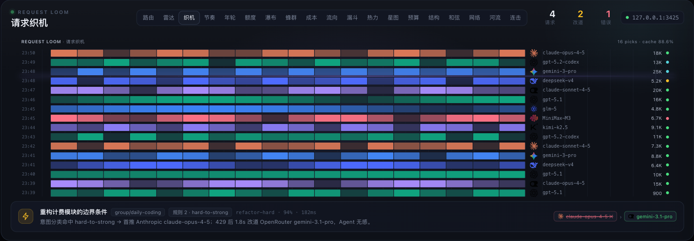
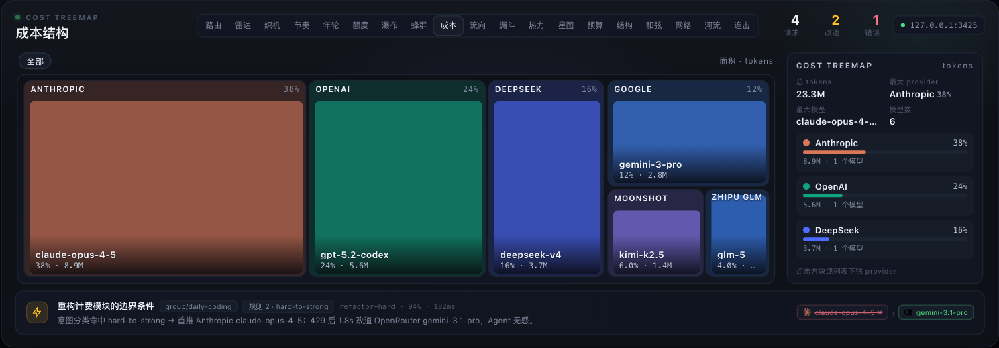
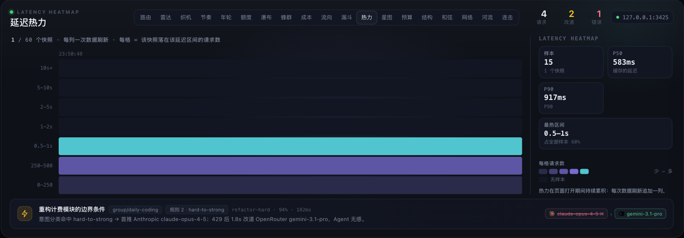

# Magpie Observatory · 喜鹊观测台

**Magpie 的实时监看驾驶舱。** 双向喜鹊把请求带向供应商、再把回答带回来；
周围是额度、用量、会话和 53 周节奏。

[English](README.md) · **简体中文**


## 是什么

Magpie 已经知道每个请求走的是哪个 provider、账号和模型。Observatory 把这股
数据流变成可以“看”的东西：

- **实时路由**：Agent → Magpie → Provider/Account；实心喜鹊带请求飞出去，
  镜像描边喜鹊带回答飞回来；失败改道保留“已改道”标记。
- **十九种视图**：`路由` / `雷达` / `织机` / `节奏` / `年轮` / `额度` / `瀑布` / `蜂群` / `成本` / `流向` / `漏斗` / `热力` / `星图` / `预算` / `结构` / `和弦` / `网络` / `河流` / `连击`。
- **四套风格**：`控制室` / `像素` / `纸感` / `霓虹`，每套都有明暗两版；
  明暗和风格互相独立。
- **布局设置**：自动 / 一屏 / 舒展；密度 紧凑 / 标准 / 宽松；动效 全部 / 轻柔 / 关闭。
- **额度**：每个账号的最短窗口，3 列环形卡片（≤1400px 两列，手机单列），
  带重置倒计时和余额。
- **用量**：24h/7d/30d Token + 费用、模型环图、53 周热力图（窄屏压缩）、可搜索请求账本。
- **会话**：活跃请求、子 Agent、TPS、改道次数；最近完成的会话留在侧栏。
- **响应式**：桌面一屏，手机单列 + 紧凑侧栏；同一份数据，没有单独的移动端构建。

## 图标


一只在轨道上的喜鹊：白色鸟身是请求/回答的双向路径，虚线环是观测台，
青色眼睛代表实时网关。

## 作为 Magpie 插件安装

需要较新的 Magpie，支持 **plugin page** 和 **page service**
（`magpie.page.service`）：

```bash
magpie plugin add github:JohnWangggg/magpie-observatory
```

或在 Magpie 中打开 **Plugins → Add plugin**，粘贴 GitHub 地址或搜索
**Magpie Observatory**。在 **Plugins → Installed** 打开后，侧边栏 Plugins
组会出现 **观测台 / Observatory** 标签。

插件会在 `127.0.0.1:3488` 启动一个只读本地服务（可在插件设置里改端口）。
Magpie 里看到的页面只是启动器；真正的仪表板由这个服务提供，因此可以读取
Magpie 的实时接口，而不需要放宽页面的 `connect-src 'none'` 沙箱。

### 从本地目录安装

```bash
git clone https://github.com/JohnWangggg/magpie-observatory.git
magpie plugin add ./magpie-observatory
```

### 商店发现

Magpie 的 Discover 通过 GitHub topic **`magpie-plugin`** 和已提交的
`magpie.page.file`（`page/index.html`）发现本插件。列表文案来自
`magpie.name` 与 `magpie.summary.en` / `.zh`；搜索关键词在 `package.json`。
完整的 topic 列表和发布命令见 [`docs/publishing.md`](docs/publishing.md)。

## 不装 Magpie 也能预览

需要 Node.js 18+：

```bash
node preview.mjs
# → http://127.0.0.1:8777
```

默认是演示模式。点右上角 **演示数据 / 实时连接** 可以尝试连接本机 Magpie
（`http://127.0.0.1:3425`）：

```bash
MAGPIE_URL=http://127.0.0.1:3425 MAGPIE_KEY=... node preview.mjs
```

预览只用于开发；插件内部使用同一个服务。

## 十九种视图

| 路由 · 双向喜鹊 | 雷达 · Provider 环与额度 |
| --- | --- |
|  |  |

| 织机 · 请求织成彩带 | 节奏 · Provider 轨道与音符 |
| --- | --- |
|  |  |

| 年轮 · 半年的极坐标日历 | 额度 · 燃尽与配速 |
| --- | --- |
|  |  |

| 瀑布 · 会话时间轴 | 蜂群 · 各 Provider 的 TTFT 分布 |
| --- | --- |
|  |  |

| 成本 · Provider × 模型面积 | 流向 · Agent → Provider → 模型 |
| --- | --- |
|  |  |

| 漏斗 · 请求到成功 | 热力 · 时间 × 延迟 |
| --- | --- |
|  |  |


| 预算 · 阈值与配速 | 结构 · Provider × 模型马赛克 |
| --- | --- |
|  |  |


| 网络 · Agent ↔ Provider 关系图 | 河流 · Provider 流量随时间 |
| --- | --- |
|  |  |


- **路由**：默认视图。喜鹊沿整条 `Agent → Magpie → Provider` 路径飞行，
  失败尝试仍然留在画面上。
- **雷达**：Provider 在环上，外圈是额度；左边是 In-flight 会话，右边是
  Quota Rings 和 Cache 命中。
- **织机**：最近请求织成彩色横带，颜色 = Provider，亮度 = Token 密度，
  织机梭子向下移动。
- **节奏**：每个 Provider 一条轨道，请求落在 16 个节拍格上；播放头循环扫过，
  底部保留 combo / cache 统计。
- **年轮**：最近 26 周铺成极坐标日历；7 圈代表周一到周日，一列一周，
  点的大小和颜色表示 Token，今天有一圈绿色描边。
- **额度**：每个账号的窗口画成燃尽线，并外推重置时的剩余量；
  绿 / 琥珀 / 红三档风险、重置虚线和 `QUOTA PACE` 侧栏。
- **瀑布**：每个会话一行甘特；浅色首字段 + 深色流式段，失败斜纹，
  点击会话聚焦。
- **蜂群**：每个 Provider 一条轨道，TTFT 点带 P50/P90 线，点大小 = Token；
  缺少首字样本的点标为估计值。
- **成本**：Provider → 模型的 Token 面积树图；点击 Provider 下钻到模型。
- **流向**：Agent → Provider → 模型三列流向；带宽 = Token，颜色 = Provider，
  悬停高亮整条路由。
- **漏斗**：发出 → 未取消 → 首字 → 成功，带流失量、成功率/错误率和改道 chip。
- **热力**：时间 × 延迟区间的热力图，页面打开期间持续累积；侧栏是 P50/P90
  和最热区间。
- **星图**：Provider 作为行星分布在椭圆轨道上；行星大小 = 活跃会话，
  外圈弧 = 额度使用，卫星 = 活跃会话。
- **预算**：每个账号窗口一条 bullet；70/88 阈值、历史配速三角和预计期末值。
- **结构**：列宽 = Provider 占比，带高 = 模型占比；点击 Provider 展开该列。
- **和弦**：Agent 在左弧、Provider 在右弧；彩带面积 = Token，悬停高亮整条流向，
  侧栏列出 top 路由。
- **网络**：Agent → Provider → 模型的力导向关系图；节点大小 = Token，
  悬停/点击高亮邻居。
- **河流**：Provider Token 增量随缓冲快照的 streamgraph，可切换 Horizon
  紧凑读数。
- **连击**：游戏化可选视图；每个请求是一张卡，连续成功累积 combo，
  分数和倍率都来自真实账本。

## 风格与明暗

| 控制室 | 像素 |
| --- | --- |
|  |  |

| 纸感 | 霓虹 |
| --- | --- |
|  |  |

- **控制室**：玻璃卡片、紫青强调，密度和可读性最均衡。
- **像素**：2px 硬边框、4px 硬阴影、等宽字、扫描线、Game Boy 绿；
  浅色版是白天的 Game Boy。
- **纸感**：米白、衬线、棕色墨迹、纸张纹理；深色版是午夜纸张。
- **霓虹**：黑底、品红/青色辉光，适合雷达和夜间大屏；也有日光版。

左侧栏 **明暗** 切昼夜，**风格** 切四套艺术方向；两项分别记忆。

同一套「控制室」的浅色版：


| 风格菜单 | 布局与动效 |
| --- | --- |
|  |  |

## 布局与动效

点左侧栏 **设置**：

| 设置 | 选项 |
| --- | --- |
| 布局 | `自动` · `一屏` · `舒展` |
| 密度 | `紧凑` · `标准` · `宽松` |
| 动效 | `全部` · `轻柔` · `关闭` |

**一屏** 在 ≥1200×900 时把整个面板压进视口，列表在卡片内部滚动；
更小的窗口自动回退到滚动并提示。**舒展** 始终使用自然高度。
关闭动效后，喜鹊停在路径中点，雷达扫描、织机梭子、节奏播放头全部停止。

## 手机上的样子

宽度小于 680px 时，侧栏只留图标，额度卡改为单列，请求账本隐藏次要列，
四种路由视图纵向重排。仍然是同一份 HTML，没有单独的移动端应用。


## 数据来源

本地服务只代理 Magpie 文档里的只读接口：

| Magpie 接口 | 用途 |
| --- | --- |
| `GET /v1/magpie/trace?after=0` | 路由、尝试、规则、会话 |
| `GET /v1/magpie/quotas?kept=1` | 账号额度窗口和余额 |
| `GET /v1/magpie/usage?period=…` | USD 估值、序列、模型 |
| `GET /v1/magpie/concurrency` | 在飞/排队请求 |
| `GET /v1/magpie/usage/requests?period=…` | 请求账本 |
| `GET /api/usage/heatmap?period=all` | 热力图（GUI / `magpie web`） |

如果 GUI 的热力图路由不存在（headless / tray 网关会返回 404），服务会用
`/v1/magpie/usage?period=all` 的每日序列补齐同样的日期格子，并缓存 5 分钟；
不读取 prompt 或回复正文。

不保存 prompt、回复、凭据或模型调用密钥。服务只监听 loopback；插件页面通过
自己的 origin 访问它。

### 隐私

- **截图全部使用演示数据。** README 里的账号都是合成的
  （`demo-…@example.com`），不包含真实 provider 账号、密钥或个人邮箱。
- **只读。** 服务只对上面六个文档化接口发 `GET`，不写 Magpie，也不写供应商 API。
- **不留 prompt。** 请求、回复、模型调用密钥和网关密钥只经过 Magpie；
  Observatory 只保留它渲染所需的计数和元数据。
- **只绑 loopback。** 服务监听 `127.0.0.1`，插件页面也从同一 origin 提供。

## 项目结构

```text
index.mjs              Magpie 插件入口；启动本地服务
server.mjs             只读 Magpie 代理 + 静态服务
preview.mjs            独立预览（node preview.mjs）
page/index.html        Magpie 插件启动页
page/boot.js           读取 magpie.service / port 并导航
page/icon.svg          插件图标
public/                仪表板（index.html、assets/）
public/assets/views/   独立 hero 视图模块
docs/research.md       调研与设计（简体中文）
docs/research.en.md    调研与设计（English）
docs/publishing.md     GitHub 发布 + Magpie 商店 topics
docs/visual-forms.md   展现形式调研（中文）
docs/visual-forms.en.md 展现形式调研（English）
scripts/               发布脚本
```

## 开发

```bash
npm run check          # node --check 入口、服务和浏览器脚本
node preview.mjs        # 演示 + 可选真实网关
```

仪表板是纯 HTML/CSS/JS，没有构建步骤，也没有运行时依赖；插件宿主用 Bun 运行，
预览用 Node 18+。

## 链接

- Magpie: https://github.com/yetone/magpie
- 插件文档: https://github.com/yetone/magpie/blob/main/docs/subsystems/plugin-runtime.md
- 调研笔记: [`docs/research.md`](docs/research.md)（中文）·
  [`docs/research.en.md`](docs/research.en.md)（English）
- 展现形式调研: [`docs/visual-forms.md`](docs/visual-forms.md)（中文）·
  [`docs/visual-forms.en.md`](docs/visual-forms.en.md)（English）
- 发布与商店 topics: [`docs/publishing.md`](docs/publishing.md)
- Issues: https://github.com/JohnWangggg/magpie-observatory/issues

## 许可

MIT © 2026 JohnWangggg。图标来自 Magpie 与 LobeHub Icons（MIT）；
见 [`public/assets/icons/LICENSE`](public/assets/icons/LICENSE)。
