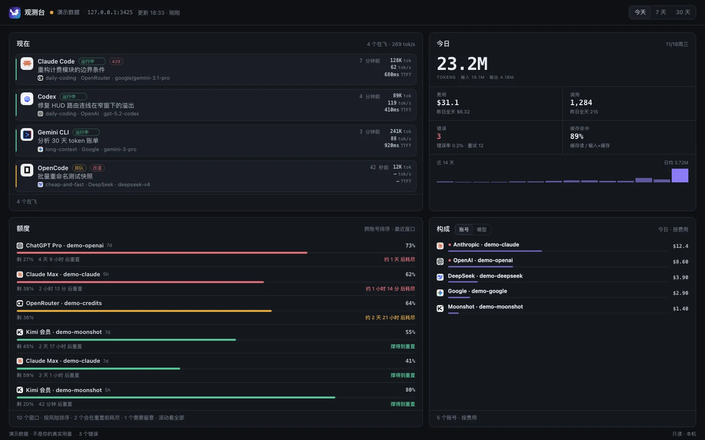

# Magpie Observatory · 喜鹊观测台

**Magpie 的一屏观测台。** 打开只看三件事：现在在跑什么、今天花了多少、
哪个额度会在重置前耗尽。

[English](README.md) · **简体中文** · [更新日志](CHANGELOG.md)



<sub>截图使用演示数据（左上角为「演示数据」时不是你的真实用量）。</sub>

## 三个问题

| 现在 | 今天 | 额度 |
| --- | --- | --- |
| 在飞会话、Agent、实际服务商与模型、TTFT、tok/s、改道次数 | Token、费用、调用、错误、缓存命中，以及近 14 天走势 | 每个账号的窗口（按风险排序）：余量、重置倒计时、按最近消耗速度推算的耗尽时间 |

Token 按**输入 + 输出**统计，和 Magpie 自己的 Usage 页一致；缓存读取单独显示
为「缓存命中」，不混进 Token 大字。

额度按「账号 + 窗口」显示，所以同一个 provider 的多个账号能区分；「构成」
默认按账号费用排序，账号前的红点表示该账号有额度会在重置前耗尽。额度行的
颜色：红=会在重置前耗尽或余量 ≤10%，黄=刚好/接近或余量 ≤20%，绿=撑得到重置，灰=数据不足。

额度这一栏是重点：它不只知道「用了 73%」，还会把**最近的消耗速度**和
**重置时间**放在一起比较。撑得到重置的显示绿色；会在重置前烧完的显示红色
和预计耗尽时间。为了不拿 18 分钟的突发去外推 30 天窗口，预测优先用最近
90 分钟，历史不够时用本窗口平均，仍不够就写「数据不足」。

## 安装

需要支持 plugin page / page service 的 Magpie：

```bash
magpie plugin add github:JohnWangggg/magpie-observatory
```

装好后在 **Plugins → Installed** 打开「观测台」，或在侧边栏 Plugins 组点
**观测台**。也可以从本地目录安装：

```bash
git clone https://github.com/JohnWangggg/magpie-observatory.git
magpie plugin add ./magpie-observatory
```

### Magpie 的 Usage 页里还有一块

装上后，Magpie 自己的 **Usage** 页底部会多一块「今日一眼」：今日 Token、
费用、调用、错误，对比近 7 天日均，以及今天最多的模型。它用 Magpie 原生
bridge，只读 `usage:summary`，不经过本地服务。

### 打不开时

页面先由 Magpie 的插件页导航到本地服务（`127.0.0.1:3488`）。如果看到空白
或「无法连接」：

1. 在 Magpie 的 **Plugins → Installed** 里把「观测台」关掉再打开；
2. 仍不行就 `magpie plugin off magpie-observatory && magpie plugin on magpie-observatory`；
3. 确认 3488 没有被别的程序占用：`lsof -nP -iTCP:3488 -sTCP:LISTEN`。

新版服务会在端口被上一次的进程占着时直接接管，旧版本会主动让出端口，
所以更新后不需要手动结束进程。

## 和 Magpie 自带页面的区别

Magpie 的 Routing/Usage 是完整的控制台：实时路由舞台、逐账号额度卡和走势、
请求账本、按 Agent/模型/账号拆分。Observatory 不重复这些深挖，只做一件事：
**把「现在、今天、额度风险」并成一屏，并跨账号排序。**

| 问题 | Magpie 自带 | Observatory |
| --- | --- | --- |
| 现在谁在跑、为什么改道 | Routing 舞台，最详细 | 一屏 3–4 行，带账号、路由组和失败码 |
| 今天花了多少 | Usage 概览，最详细 | 一屏数字 + 较昨日全天/日均 |
| 哪个账号会先没额度 | 额度卡墙，逐卡走势 | **跨账号风险排序**，直接标出「会在重置前耗尽」 |
| 今天谁在花钱 | 账号拆分，在页面下方 | **同屏 Top 4 账号**（可切模型；红点=该账号有额度风险） |
| 深挖一条请求 | Routing 的最近请求/重放 | 不做，留给 Magpie |

它不替代 Magpie 的页面；它是打开 Magpie 后的第一眼。需要逐请求账本、
额度走势图或签到，仍然去 Magpie 自带的 Usage/Routing。

## 为什么只有一屏

原来的版本有 25 个视图、7 套风格、等级/徽章/回放/分享卡/每日摘要弹窗。
数据没错，但每天打开要学、要翻、要关弹窗。对长期使用来说，这些是噪声。

这一版只做 Magpie 自带页面**没有放在一起**的三件事：

- Magpie 的 Usage 页有逐账号额度卡和「按此速度」预测，但要在多列卡片里
  逐个扫；我们把所有账号的窗口按风险排成一张表，先看最可能先耗尽的；
- Magpie 的 Routing 页有实时舞台，但一屏同时看「在飞 + 今天花费 + 额度风险」
  需要来回切页；
- 其余深挖（逐请求账本、额度走势图、签到、延迟分布）留在 Magpie 自己的
  页面里，不在这里重复。

完整的功能评估、竞品调研和删除清单见 [`docs/product-review-v2.md`](docs/product-review-v2.md)。

## 它读什么

本地服务只代理 Magpie 文档里的只读接口：

| Magpie 接口 | 用途 |
| --- | --- |
| `GET /v1/magpie/trace?after=…` | 在飞/最近完成的路由、尝试、改道 |
| `GET /v1/magpie/quotas?kept=1` | 账号额度窗口与重置时间 |
| `GET /v1/magpie/quotas/history` | 额度消耗曲线（算速度） |
| `GET /v1/magpie/usage?period=today\|7d\|30d` | Token、费用、调用、错误、模型 |
| `GET /v1/magpie/concurrency` | 在飞与排队 |

「今日一眼」panel 走 Magpie 原生 bridge，只读 `usage:summary`，不经过这个
服务；主页面才用上面的接口。

- **只读。** 不写 Magpie，不调用供应商 API。
- **不读 prompt 或回复正文。** 只保留渲染所需的计数和元数据。
- **只绑 loopback。** 服务监听 `127.0.0.1:3488`（可在插件选项里改端口）。
- **沙箱口令。** 页面在 Magpie 的 sandbox 里以 `Origin: null` 访问服务，服务用
  `~/.config/magpie/observatory-page-token`（权限 600）里的随机口令认证；
  它不是 Magpie 凭据，也不离开本机。
- **3 秒刷新。** 首帧之后只发增量路由、增量账本和额度历史哈希；页面切后台
  自动停轮询。
- **跟随 Magpie 明暗。** 页面读 `?hostTheme=` 和 `--magpie-*` 变量，不另做
  一套主题系统。
- **跟随 Magpie 语言。** 页面和 Usage panel 自动切换中文 / English（启动页把
  宿主的 `lang` 带过来）；系统告警文案目前固定中文。

## 开发

需要 Node.js 18+：

```bash
npm run preview
# → http://127.0.0.1:8777
```

预览默认连本机 Magpie（`127.0.0.1:3425`）；连不上时回退到演示数据。
加上 `?demo=1` 可以强制演示数据；`?lang=zh` / `?lang=en` 切换语言：

```
http://127.0.0.1:8777/?demo=1&lang=zh
```

检查语法和额度预测：

```bash
npm run check   # 包含 npm test
```

## 结构

```text
index.mjs              Magpie 插件入口；启动本地服务
server.mjs             只读 Magpie 代理 + 静态服务
preview.mjs            独立预览（node preview.mjs）
page/index.html        Magpie 插件启动页（导航到服务）
page/boot.js           读取 magpie.service / port 后导航
public/focus.html      一屏观测台
public/assets/focus.js 数据、额度预测、渲染
public/assets/quota.js 额度预测（可单测）
public/assets/focus.css
public/assets/data.js  只读快照适配与演示数据
panels/usage.html      Magpie Usage 页里的「今日一眼」
panels/usage.js
panels/usage.css
scripts/test-quota.mjs 额度预测回归测试
```

## 额度告警

装上并在 Magpie 里打开过一次后，本地服务会每 5 分钟检查一次。某个窗口按
当前速度会在重置前耗尽时，用系统通知提醒：macOS 走 `osascript`，Linux 走
`notify-send`；同一窗口 6 小时内最多一次，一次检查最多合并成一条（前 3 个
窗口 + “另有 N 个”）。服务启动 20 秒后做第一次检查。

关闭：

```bash
magpie plugin options magpie-observatory '{"notify":false}'
```

告警只读 `/v1/magpie/quotas` 与 `/v1/magpie/quotas/history`，只发本机系统
通知，不联网、不写 Magpie。Windows 目前只写服务日志，不弹系统通知。

## 遇到 snapshot 403

403 来自服务的沙箱口令校验：页面 HTML 带一个口令，`Origin: null` 的请求必须
带同一个口令。插件宿主重启（更新、开关插件、Magpie 重启）后，旧页面可能还
拿着上一个口令。

- 新版口令持久化在 `~/.config/magpie/observatory-page-token`，服务重启不再换；
- 页面收到 403 会自动带 `tokenReload=1` 刷新一次，重新拿口令；
- 如果仍看到 403，手动刷新页面一次即可。

## 已知边界

- **「较昨日全天」不是同期比较。** 今天只过了一半时，跟昨天全天比会偏低；
  所以这一行写「较昨日全天」，并且不用红绿误导。7 天/30 天显示日均。
- **额度预测是线性的。** 用最近消耗斜率或本窗口平均外推，突发流量、限流
  和额度重置会改变结果；数据不足时明确写「数据不足」，不硬给预测。
- **费用是 Magpie 的官方估值。** 没有定价的请求不会被编造成费用。
- **只适用于单网关。** 多网关切换留在 Magpie 自己的配置里；这里不重复做。
- **告警依赖本地服务。** 服务随插件宿主启动；如果 Magpie 从未打开过插件，
  第一次告警可能要等页面打开后才会开始检查。

## 旧版本

v1 的 25 视图仪表板已从仓库删除，也不再打进 npm 包；`/index.html` 会重定向
到一屏观测台。评估与删除原因、完整的旧版清点在
[`docs/product-review-v2.md`](docs/product-review-v2.md)（文件路径指 v2 删除前的
v1.10.130 树）。

## License

MIT
