# Magpie Observatory · 喜鹊观测台

**Magpie 的实时监看驾驶舱。** 双向喜鹊把请求带向供应商、再把回答带回来；
周围是额度、用量、会话和 53 周节奏。

[English](README.md) · **简体中文**


## 是什么

Magpie 已经知道每个请求走的是哪个 provider、账号和模型。Observatory 把这股
数据流变成可以“看”的东西：

- **实时路由**：Agent → Magpie → Provider/Account；实心喜鹊带请求飞出去，
  镜像描边喜鹊带回答飞回来；失败改道保留“已改道”标记。
- **四十五种视图**：`路由` / `雷达` / `织机` / `节奏` / `年轮` / `额度` /
  `瀑布` / `蜂群` / `成本` / `流向` / `漏斗` / `热力` / `星图` / `预算` /
  `结构` / `和弦` / `网络` / `河流` / `连击` / `工厂` / `蜂巢` / `夜航` /
  `博弈` / `燃烧` / `K线` / `仪表盘` / `绽放` / `培养皿` / `极光` / `星座` / `潮汐` / `棱镜` / `玻璃缸` / `回声` / `马赛克` / `折纸` / `萤火虫` / `曼陀罗` / `拼布` / `漩涡` / `万花筒` / `彗星轨道` / `雨幕` / `气泡` / `频谱`——一种看路由，四十四种看同一份数据。
- **七套风格**：`控制室` / `像素` / `纸感` / `霓虹` / `终端` / `蓝图` / `拼贴`，
  每套都有明暗两版；明暗和风格互相独立。
- **布局设置**：自动 / 一屏 / 舒展；密度 紧凑 / 标准 / 宽松；动效 全部 / 轻柔 / 关闭。
- **额度**：每个账号的最短窗口，3 列环形卡片（≤1400px 两列，手机单列），
  带重置倒计时和余额。
- **用量**：24h/7d/30d Token + 费用、模型环图、53 周热力图（窄屏压缩）、可搜索请求账本。
- **会话**：活跃请求、子 Agent、TPS、改道次数；最近完成的会话留在侧栏。
- **响应式**：桌面一屏，手机单列 + 紧凑侧栏；同一份数据，没有单独的移动端构建。
- **影院模式**：`O` 让当前视图占满全屏，只留一条漂浮 HUD；配合 `G` 巡游
  就是一块可以挂在副屏上的氛围屏。
- **命令面板**：`⌘K` 一个搜索框跳转任意视图、风格或动作。
- **每日摘要**：每天首次打开出昨日报告（tokens / 调用 / 连续天数 / 最常用
  Agent），关闭当日不再弹。
- **成就系统**：8 枚徽章（连续天数 / 单日 1M、10M tokens / 三路并发 /
  夜航人），解锁时 toast，localStorage 记达成日期。
- **注意力条**：英雄卡左下角一排安静的小胶囊：配额告急、错误突增、
  连续天数、今日一句话。
- **收藏夹常驻**：收藏的视图（F）变成左侧 rail 的常驻图标，一点即切。
- **Mini 模式**：`?mode=mini&view=stellar` 把页面缩成画中画可用的挂件。
- **PWA**：`manifest.webmanifest` + 最小 service worker，可安装到主屏；
  网络优先、API 不缓存。
- **回放**：`R` 冻结成 3 分钟可拖时间轴；`▶` 自动播放、`⤴` 复制
  `#replay=` 链接，命令面板可导出自足 HTML 播放器（帧内嵌）。
- **分享卡**：`⌘K` 导出 1200×630 PNG——今日 / 本周 / 近30天 / 今日vs昨日
  对比；`⌘K` 复制页面链接（恢复视图/区间/影院）。
- **周报卡**：`⌘K` → 本周报告出 7 天柱状 + 峰值日 + 最热路由。
- **开局视图**：Westworld 转盘，每次请求一个节拍：PERFECT/GREAT/GOOD/
  MISS 判定、连击倍数、`←`/`→` 在调用流上步进。
- **网关对比**：`⌘K` → 网关对比并列默认与锁定网关的四指标。
- **等级与成就**：请求攒 XP 进顶栏等级胶囊；8 枚徽章 + 个人战绩跨
  会话持久。

## 图标


一只在轨道上的喜鹊：白色鸟身是请求/回答的双向路径，虚线环是观测台，
青色眼睛代表实时网关。

## 作为 Magpie 插件安装

需要较新的 Magpie，支持 **plugin page** 和 **page service**
（`magpie.page.service`）：

```bash
magpie plugin add github:JohnWangggg/magpie-observatory
```

或在 Magpie 中打开 **Plugins → Add plugin**，粘贴 GitHub 地址或搜索
**Magpie Observatory**。在 **Plugins → Installed** 打开后，侧边栏 Plugins
组会出现 **观测台 / Observatory** 标签。

插件会在 `127.0.0.1:3488` 启动一个只读本地服务（可在插件设置里改端口）。
Magpie 里看到的页面只是启动器；真正的仪表板由这个服务提供，因此可以读取
Magpie 的实时接口，而不需要放宽页面的 `connect-src 'none'` 沙箱。Magpie
用 `sandbox="allow-scripts"` 装载页面，因此服务会对框架的 `Origin: null`
返回 CORS 和一个每次运行生成的口令（只有它发出的 HTML 里才有）；其他页面
读不到数据。

### 从本地目录安装

```bash
git clone https://github.com/JohnWangggg/magpie-observatory.git
magpie plugin add ./magpie-observatory
```

### 商店发现

`package.json` 声明了页面（`magpie.page.file` → `page/index.html`），安装后
在 Magpie 里就是页面类型（`magpie plugin list` 显示 `page`）。**插件市场的
卡片**来自社区注册表（`magpie-community/plugins/registry.json`，`"kind":
"page"`）；本仓库尚未列入，且需要先发布到 npm 才能提交。具体条目和 PR 步骤
见 [`docs/community-listing.md`](docs/community-listing.md)。仓库刻意不带
GitHub 的 **`magpie-plugin`** 主题：该主题供 Discover 的「供应商」半边使用，
而带本地服务（需要 `main`/`exports`）的页面会因此被标成供应商。

列表文案来自 `magpie.name` 与 `magpie.summary.en` / `.zh`；搜索关键词在
`package.json`，主题列表和发布命令见 [`docs/publishing.md`](docs/publishing.md)。

## 不装 Magpie 也能预览

需要 Node.js 18+：

```bash
node preview.mjs
# → http://127.0.0.1:8777
```

默认是演示模式。点右上角 **演示数据 / 实时连接** 可以尝试连接本机 Magpie
（`http://127.0.0.1:3425`）：

```bash
MAGPIE_URL=http://127.0.0.1:3425 MAGPIE_KEY=... node preview.mjs
```

预览只用于开发；插件内部使用同一个服务。

## 四十五种视图

| 路由 · 双向喜鹊 | 雷达 · Provider 环与额度 |
| --- | --- |
|  |  |

| 织机 · 请求织成彩带 | 节奏 · Provider 轨道与音符 |
| --- | --- |
|  |  |

| 年轮 · 半年的极坐标日历 | 额度 · 燃尽与配速 |
| --- | --- |
|  |  |

| 瀑布 · 会话时间轴 | 蜂群 · 各 Provider 的 TTFT 分布 |
| --- | --- |
|  |  |

| 成本 · Provider × 模型面积 | 流向 · Agent → Provider → 模型 |
| --- | --- |
|  |  |

| 漏斗 · 请求到成功 | 热力 · 时间 × 延迟 |
| --- | --- |
|  |  |


| 预算 · 阈值与配速 | 结构 · Provider × 模型马赛克 |
| --- | --- |
| 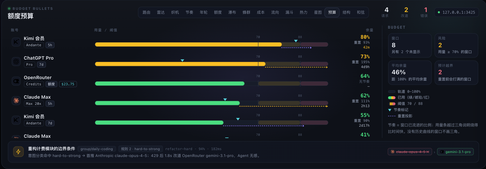 |  |


| 网络 · Agent ↔ Provider 关系图 | 河流 · Provider 流量随时间 |
| --- | --- |
|  |  |


| 工厂 · 排队 → 流式 → 完成 | 蜂巢 · 会话绕着 Provider 飞 |
| --- | --- |
| 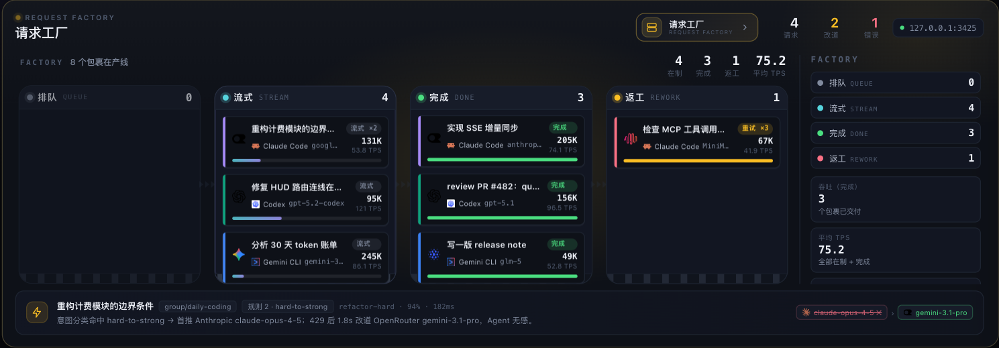 | 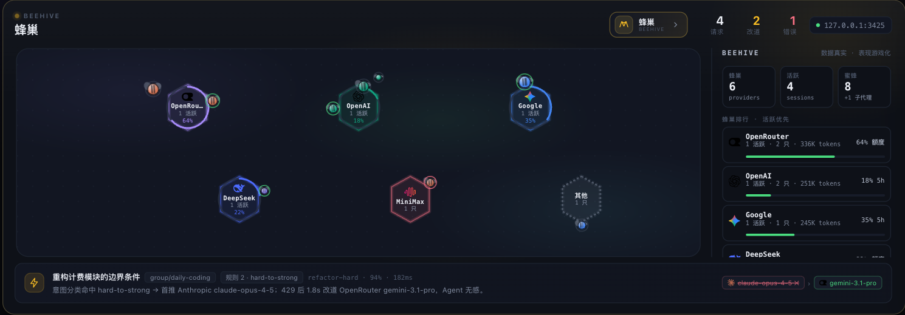 |

| 夜航 · Provider 星、请求流星 | 燃烧 · 配额窗口配速 |
| --- | --- |
|  |  |

| K线 · 每小时吞吐的 OHLC | 仪表盘 · KPI 与配额表盘 |
| --- | --- |
|  |  |

| 绽放 · 请求长成花 | 培养皿 · 请求活细胞 |
| --- | --- |
|  |  |

| 极光 · 请求是天空光带 | 星座 · 会话是星图 |
| --- | --- |
|  | 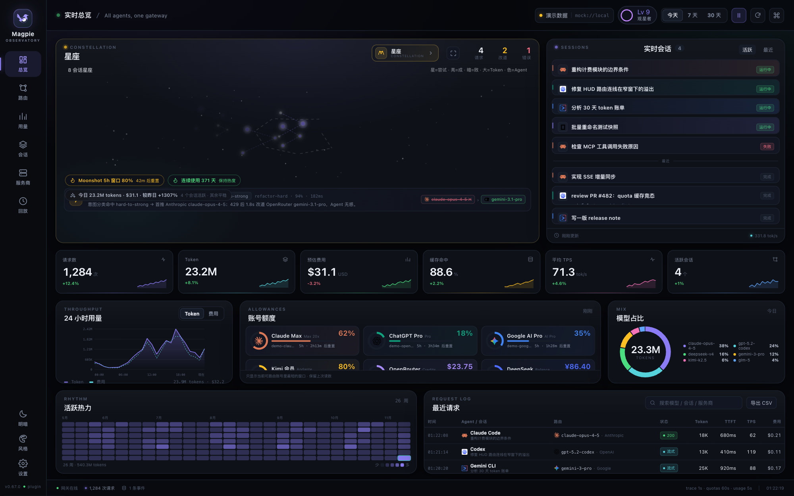 |

| 潮汐 · Provider 波浪拍岸 | 棱镜 · 白光分光 |
| --- | --- |
|  | 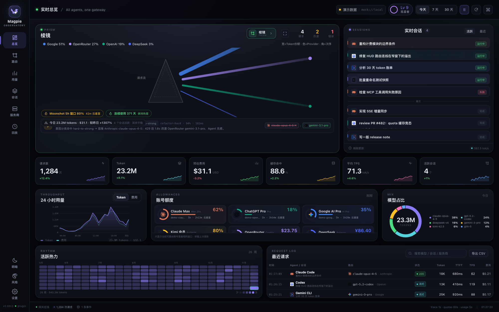 |

| 玻璃缸 · 会话是密封小生态 | 回声 · 水面涟漪 |
| --- | --- |
|  |  |

| 马赛克 · 请求是墙上一块砖 | 折纸 · 会话是纸鹤 |
| --- | --- |
| 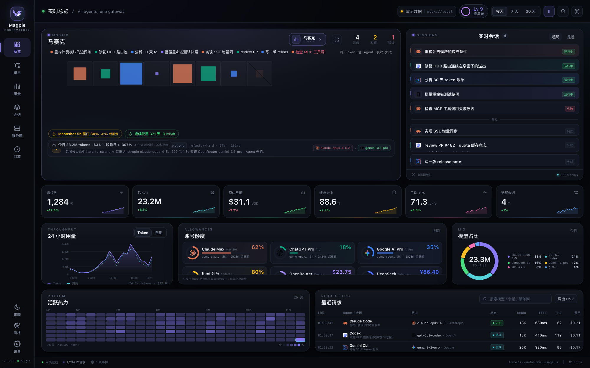 |  |

| 萤火虫 · 会话是夜里光点 | 曼陀罗 · 会话是花瓣 |
| --- | --- |
| 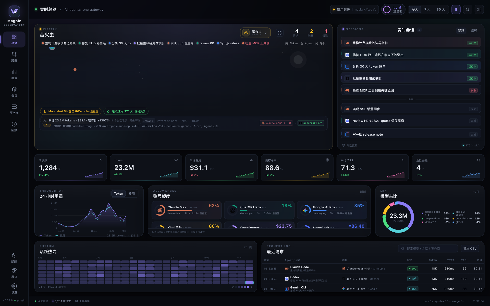 | 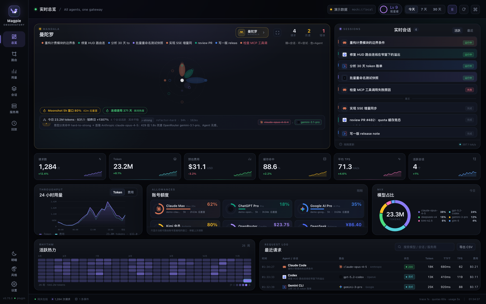 |

| 拼布 · 会话是一块布 | 漩涡 · 会话是螺旋粒子 |
| --- | --- |
|  | 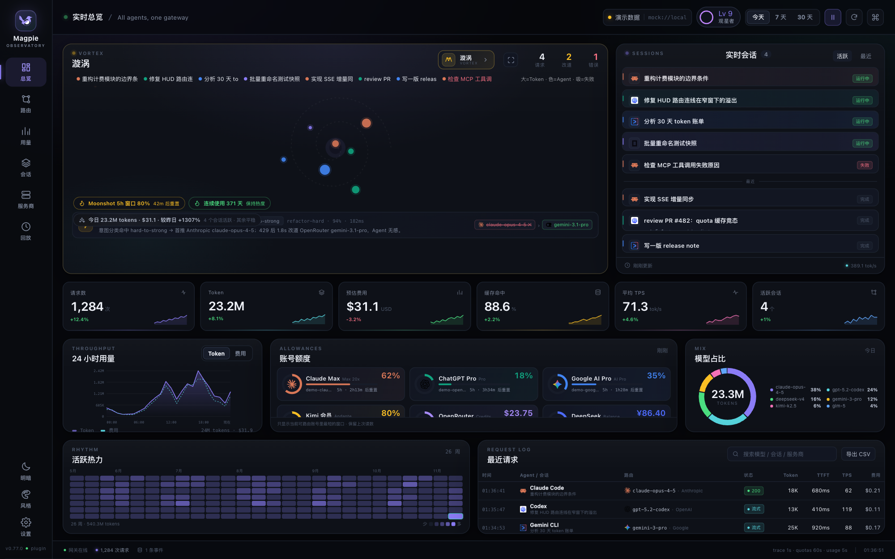 |

| 万花筒 · 会话是十二折楔 | 彗星轨道 · 会话是彗星 |
| --- | --- |
|  |  |

| 雨幕 · 请求是雨滴落地 | 气泡 · 会话是上浮水泡 |
| --- | --- |
|  | 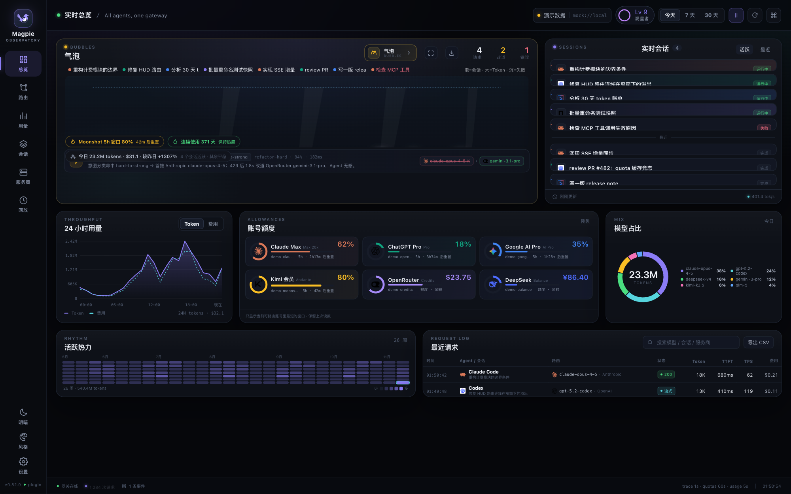 |

| 频谱 · Token 流频谱 |
| --- |
|  |

- **路由**：默认视图。喜鹊沿整条 `Agent → Magpie → Provider` 路径飞行，
  失败尝试仍然留在画面上。
- **雷达**：Provider 在环上，外圈是额度；左边是 In-flight 会话，右边是
  Quota Rings 和 Cache 命中。
- **织机**：最近请求织成彩色横带，颜色 = Provider，亮度 = Token 密度，
  织机梭子向下移动。
- **节奏**：每个 Provider 一条轨道，请求落在 16 个节拍格上；播放头循环扫过，
  底部保留 combo / cache 统计。
- **年轮**：最近 26 周铺成极坐标日历；7 圈代表周一到周日，一列一周，
  点的大小和颜色表示 Token，今天有一圈绿色描边。
- **额度**：每个账号的窗口画成燃尽线，并外推重置时的剩余量；
  绿 / 琥珀 / 红三档风险、重置虚线和 `QUOTA PACE` 侧栏。
- **瀑布**：每个会话一行甘特；浅色首字段 + 深色流式段，失败斜纹，
  点击会话聚焦。
- **蜂群**：每个 Provider 一条轨道，TTFT 点带 P50/P90 线，点大小 = Token；
  缺少首字样本的点标为估计值。
- **成本**：Provider → 模型的 Token 面积树图；点击 Provider 下钻到模型。
- **流向**：Agent → Provider → 模型三列流向；带宽 = Token，颜色 = Provider，
  悬停高亮整条路由。
- **漏斗**：发出 → 未取消 → 首字 → 成功，带流失量、成功率/错误率和改道 chip。
- **热力**：时间 × 延迟区间的热力图，页面打开期间持续累积；侧栏是 P50/P90
  和最热区间。
- **星图**：Provider 作为行星分布在椭圆轨道上；行星大小 = 活跃会话，
  外圈弧 = 额度使用，卫星 = 活跃会话。
- **预算**：每个账号窗口一条 bullet；70/88 阈值、历史配速三角和预计期末值。
- **结构**：列宽 = Provider 占比，带高 = 模型占比；点击 Provider 展开该列。
- **和弦**：Agent 在左弧、Provider 在右弧；彩带面积 = Token，悬停高亮整条流向，
  侧栏列出 top 路由。
- **网络**：Agent → Provider → 模型的力导向关系图；节点大小 = Token，
  悬停/点击高亮邻居。
- **河流**：Provider Token 增量随缓冲快照的 streamgraph，可切换 Horizon
  紧凑读数。
- **连击**：游戏化可选视图；每个请求是一张卡，连续成功累积 combo，
  分数和倍率都来自真实账本。
- **工厂**：会话作为包裹经过 排队 → 流式 → 完成，错误进返工道；
  传送带和包裹有动画，计数是真实账本。
- **蜂巢**：Provider 是蜂巢、会话是蜜蜂；子 Agent 是更小的蜜蜂，
  大小跟着 Token，悬停蜂巢会高亮它的蜜蜂。

- **夜航**：Provider 是恒星、请求是流星；专为影院模式设计的氛围星空。
- **博弈**：Westworld 大转盘，每个请求一拍；盘面弧是 Token 构成，
  边缘闪错误，连胜向"上头"环推进。
- **燃烧**：每个账号窗口一条配速 bar——填充 = 已用 %、竖线 = 平速、
  虚线缺口 = 期末外推；点击行展开该窗口的 sparkline，↑↓/Enter 键盘、
  CSV 导出。
- **K线**：每个时段一根蜡烛——`open` 是上一时段的 tokens、`close` 是这一段；
  涨绿跌红、虚线均线、legend 有 升/降/连升/峰值 统计。
- **仪表盘**：每个 KPI 和配额窗口一只 270° 表盘——请求、Token、费用、
  成功率、活跃会话、在飞，再往下每账号 ≤2 个窗口一表；
  指针 + 弧，绿/黄/红三档风险。
- **绽放**：最近请求开成一座花园——Provider = 花瓣颜色、Token = 花瓣数、
  位置 = 时间；失败是永不开的花蕾，地面爬一条藤。
- **培养皿**：最近请求是培养皿里的活细胞——Provider = 胞质颜色、
  Token = 细胞大小，活细胞会呼吸和搏动，失败淡成鬼影；
  最新一簇聚在皿心。
- **极光**：最近请求是夜空里的光带——高 = Token、宽 = TPS、
  色 = Provider；失败是地平线上一条细灰痕，星星在后面闪。
- **星座**：每个会话是一张星图——每次尝试一颗星（亮=成、暗=败），
  不足 3 颗补辅星；会话间连成更大的星座图，颜色 = Agent。
- **潮汐**：Provider Token 份额是滚来的波浪——振幅 = 份额、相位漂移、
  浪头起沫，月亮拉最大那道。
- **棱镜**：请求流一道白光射进来，玻璃三角分成各家射线——
  宽 = Token、色 = Provider、角 = 次序。
- **玻璃缸**：每个会话是株植物——高 = Token、色 = Agent，
  土上苔藓、一朵蕈一次失败、玻璃挂着水滴。
- **回声**：会话滴落在水面——环 = Token、色 = Agent、
  虚线 = 失败、淡 = 越旧。
- **马赛克**：每个请求是墙上一块砖——格 = Token、色 = Agent、
  裂纹 = 失败，行间勾缝。
- **折纸**：每个会话是挂在枝头的一只纸鹤——大 = Token、
  色 = Agent、虚线 = 折痕；失败的低垂。
- **萤火虫**：每个会话是夜里一只萤火虫——亮 = Token、
  色 = Agent、闪 = 呼吸；月亮 + 星星挂着。
- **曼陀罗**：会话围绕 bindu 开花——瓣长 = Token、色 = Agent、
  环 = 尝试；虚线曼陀罗垫底。
- **拼布**：会话是一块布——大 = Token、色 = Agent、
  虚线缝线 = 失败；整床被子缝了边。
- **漩涡**：会话骑对数螺旋——大 = Token、色 = Agent、
  转 = 新旧；失败吸向中心。
- **万花筒**：每个会话是一个楔，绕六边形框镜成 12 折——
  长 = Token、色 = Agent、淡 = 失败。
- **彗星轨道**：每个会话是带尾迹的彗星，绕 Provider 日群椭圆飞行——
  头 = Token、尾 = 弧、碎 = 失败。
- **雨幕**：每个请求是一滴雨——长 = Token、色 = Agent、
  落地溅起涟漪；红 = 失败。
- **气泡**：每个会话是水里上升的气泡——大 = Token、色 = Agent、
  摇摆 = 相位；失败的下沉。
- **频谱**：Token 流是一排频峰——高 = Token、色 = Agent、
  宽 = 尝试次数；下方镜像作低音回声。

## 切换视图

英雄卡头部不再是平铺按钮，而是一个视图选择器。按 **V**（或点击）打开，
输入名称 / 英文 eyebrow / 分组即可过滤，Enter 切换；也可以点 **随机一个**。
45 个视图分为 `实时` / `用量` / `结构` / `趣味` 四组，英雄卡强调色跟着分组变化。
**G** 开启/停止巡游（间隔在设置里可选 5 / 10 / 30 秒），**R** 随机视图，
**F** 收藏当前视图（收藏会置顶并跨刷新保留），**?** 打开快捷键表，**Esc** 关闭。
按 **O** 进入**影院模式**：英雄视图占满整个窗口，只留漂浮 HUD（视图名、
实时 tokens/费用、Esc 提示）——配合 **G** 巡游就是一块可以挂着看的氛围屏。
**⌘K** 打开命令面板，一键跳转任意视图、任意风格、开关影院/巡游/明暗。
英雄卡左下角还有一条**注意力条**：配额告急、错误突增、连续使用天数、
今日一句话摘要——第一眼就知道该看哪里。

| 视图选择器 | 快捷键 |
| --- | --- |
|  |  |

## 每个面都是活的

除了切视图，卡片本身全是交互：

- **单击**——燃烧行展开 sparkline、会话卡选中并过滤日志、热力格按日过滤、
  注意力条跳对应视图。
- **右键**——消除 chip、复制 id / 模型名 / CSV、取消收藏轨、在英雄卡收藏视图。
- **双击**——复制会话尝试摘要、复制 Provider key、按月过滤日志、
  把收藏设为默认视图、复制视图名。
- **键盘**——↑↓/←→ 走每条列表（燃烧行/会话/日志/配额/收藏/面板），
  Enter 激活、Esc 收起；`/` 聚焦日志搜索。
- **悬停**——sparkline 显 `left% · at`、燃烧 bar 显配速 tooltip、
  配额项翻面显 `已用/剩余`、热力格显 `N 次 · Tok`。
- **状态**——每视图滚动位置、日志查询、燃烧选中、收藏、默认视图全部跨刷新保留。

## 风格与明暗

| 控制室 | 像素 |
| --- | --- |
|  | 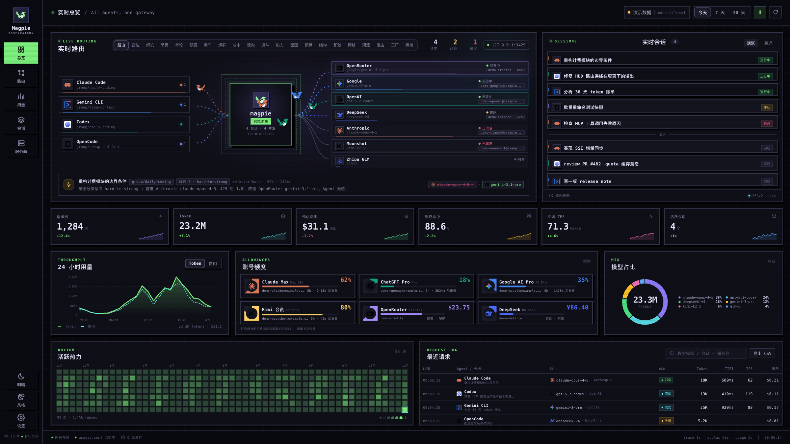 |

| 纸感 | 霓虹 |
| --- | --- |
| 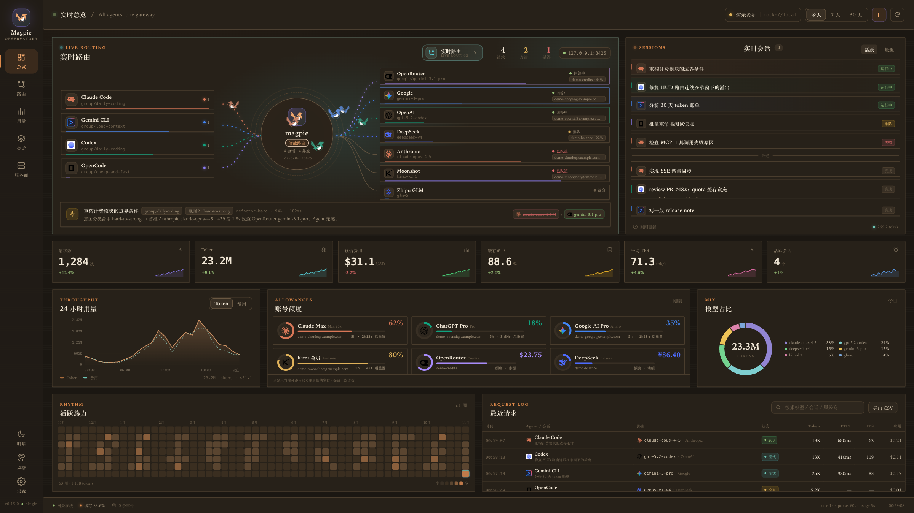 |  |

| 终端 | 蓝图 |
| --- | --- |
|  |  |

| 拼贴 | Game Boy（像素浅色） |
| --- | --- |
|  |  |

- **控制室**：玻璃卡片、紫青强调，密度和可读性最均衡。
- **像素**：8-bit 主机感——2px 粗框、硬偏移阴影、抖动网点、分段仪表、
  全大写等宽字、重扫描线；浅色版是 Game Boy DMG 屏幕。
- **纸感**：米白、衬线、棕色墨迹、纸张纹理；深色版是午夜纸张。
- **霓虹**：赛博朋克黑玻璃——品红/青色对切光、HUD 角标、透视网格地面、
  色差标题。
- **终端**：磷光 CRT——数字辉光、卡片标题块光标、重栅格、全等宽；
  浅色版是白天终端。
- **蓝图**：制图桌——深蓝图纸、24px 方格、虚线内框、刻度尺、无辉光；
  浅色版是晒白图。
- **拼贴**：丝网印剪贴——新闻纸网点、2px 墨框、硬投影、单一红色、
  荧光笔标题；深色版是黑墨新闻纸。

左侧栏 **明暗** 切昼夜，**风格** 切七套艺术方向；两项分别记忆。

同一套「控制室」的浅色版：


| 风格菜单 | 布局与动效 |
| --- | --- |
|  |  |

## 布局与动效

点左侧栏 **设置**：

| 设置 | 选项 |
| --- | --- |
| 布局 | `自动` · `一屏` · `舒展` |
| 密度 | `紧凑` · `标准` · `宽松` |
| 动效 | `全部` · `轻柔` · `关闭` |

**一屏** 在 ≥1200×900 时把整个面板压进视口，列表在卡片内部滚动；
更小的窗口自动回退到滚动并提示。**舒展** 始终使用自然高度。
关闭动效后，喜鹊停在路径中点，雷达扫描、织机梭子、节奏播放头全部停止。

## 手机上的样子

宽度小于 680px 时，侧栏只留图标，额度卡改为单列，请求账本隐藏次要列，
四种路由视图纵向重排。仍然是同一份 HTML，没有单独的移动端应用。


## 数据来源

本地服务只代理 Magpie 文档里的只读接口：

| Magpie 接口 | 用途 |
| --- | --- |
| `GET /v1/magpie/trace?after=0` | 路由、尝试、规则、会话 |
| `GET /v1/magpie/quotas?kept=1` | 账号额度窗口和余额 |
| `GET /v1/magpie/usage?period=…` | USD 估值、序列、模型 |
| `GET /v1/magpie/concurrency` | 在飞/排队请求 |
| `GET /v1/magpie/usage/requests?period=…` | 请求账本 |
| `GET /api/usage/heatmap?period=all` | 热力图（GUI / `magpie web`） |

如果 GUI 的热力图路由不存在（headless / tray 网关会返回 404），服务会用
`/v1/magpie/usage?period=all` 的每日序列补齐同样的日期格子，并缓存 5 分钟；
不读取 prompt 或回复正文。

不保存 prompt、回复、凭据或模型调用密钥。服务只监听 loopback；插件页面通过
自己的 origin 访问它。

实时轮询是增量的：首帧之后，服务只发新增的 trace 路由、新增的请求行和配额历史的哈希，
2.5 秒一次轮询约 23 KB，而不是 150 KB。

### 隐私

- **截图全部使用演示数据。** README 里的账号都是合成的
  （`demo-…@example.com`），不包含真实 provider 账号、密钥或个人邮箱。
- **只读。** 服务只对上面六个文档化接口发 `GET`，不写 Magpie，也不写供应商 API。
- **不留 prompt。** 请求、回复、模型调用密钥和网关密钥只经过 Magpie；
  Observatory 只保留它渲染所需的计数和元数据。
- **只绑 loopback。** 服务监听 `127.0.0.1`，插件页面也从同一 origin 提供。

## 项目结构

```text
index.mjs              Magpie 插件入口；启动本地服务
server.mjs             只读 Magpie 代理 + 静态服务
preview.mjs            独立预览（node preview.mjs）
page/index.html        Magpie 插件启动页
page/boot.js           读取 magpie.service / port 并导航
page/icon.svg          插件图标
public/                仪表板（index.html、assets/）
public/assets/views/   独立 hero 视图模块
docs/research.md       调研与设计（简体中文）
docs/research.en.md    调研与设计（English）
docs/publishing.md     GitHub 发布 + Magpie 商店 topics
docs/visual-forms.md   展现形式调研（中文）
docs/visual-forms.en.md 展现形式调研（English）
scripts/               发布脚本
```

## 开发

```bash
npm run check          # node --check 入口、服务和浏览器脚本
node preview.mjs        # 演示 + 可选真实网关
```

仪表板是纯 HTML/CSS/JS，没有构建步骤，也没有运行时依赖；插件宿主用 Bun 运行，
预览用 Node 18+。

## 链接

- Magpie: https://github.com/yetone/magpie
- 插件文档: https://github.com/yetone/magpie/blob/main/docs/subsystems/plugin-runtime.md
- 调研笔记: [`docs/research.md`](docs/research.md)（中文）·
  [`docs/research.en.md`](docs/research.en.md)（English）
- 展现形式调研: [`docs/visual-forms.md`](docs/visual-forms.md)（中文）·
  [`docs/visual-forms.en.md`](docs/visual-forms.en.md)（English）
- 发布与商店 topics: [`docs/publishing.md`](docs/publishing.md)
- Issues: https://github.com/JohnWangggg/magpie-observatory/issues

## 许可

MIT © 2026 JohnWangggg。图标来自 Magpie 与 LobeHub Icons（MIT）；
见 [`public/assets/icons/LICENSE`](public/assets/icons/LICENSE)。
