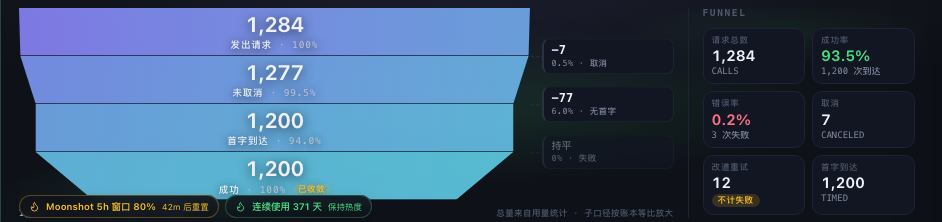

# Magpie Observatory · 视图图鉴 (8)

按分组列出每个视图的名称、eyebrow 与一句话描述。视图目录由 `public/assets/app.js` 的 `VIEW_META` 维护；
运行时 `window.ObservatoryManifest` 只登记 id；`ObservatoryEnsureView(id)` 在第一次打开时加载对应 `views/*.js/.css`。

| 分组 | 数量 |
|---|---|
| [实时](#实时) | 3 |
| [结构](#结构) | 2 |
| [配额](#配额) | 1 |
| [用量](#用量) | 2 |

---

## 实时 (3)

| id | 标题 | eyebrow | 说明 | 预览 |
|---|---|---|---|---|
| `route` | 实时路由 | LIVE ROUTING | Agent → Provider |  |
| `live` | 会话 | SESSIONS | 时间轴 · 关系 | — |
| `delay` | 延迟 | LATENCY | 热力 · 分布 · 排行 | — |

## 结构 (2)

| id | 标题 | eyebrow | 说明 | 预览 |
|---|---|---|---|---|
| `funnel` | 请求漏斗 | REQUEST FUNNEL | 发出 → 成功 |  |
| `compose` | 构成 | MIX | 面积 · 马赛克 · 流向 · 和弦 · 模型 | — |

## 配额 (1)

| id | 标题 | eyebrow | 说明 | 预览 |
|---|---|---|---|---|
| `windows` | 额度 | QUOTA | 窗口 · 配速 · 预测 · 账户 | — |

## 用量 (2)

| id | 标题 | eyebrow | 说明 | 预览 |
|---|---|---|---|---|
| `usage` | 用量 | USAGE | 河流 · K线 · 月花费 | — |
| `rings` | Token 年轮 | YEAR IN RINGS | 26 周极坐标日历 |  |
