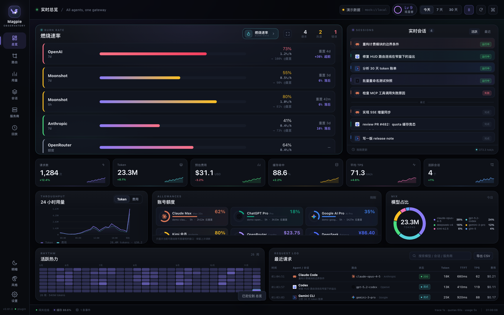
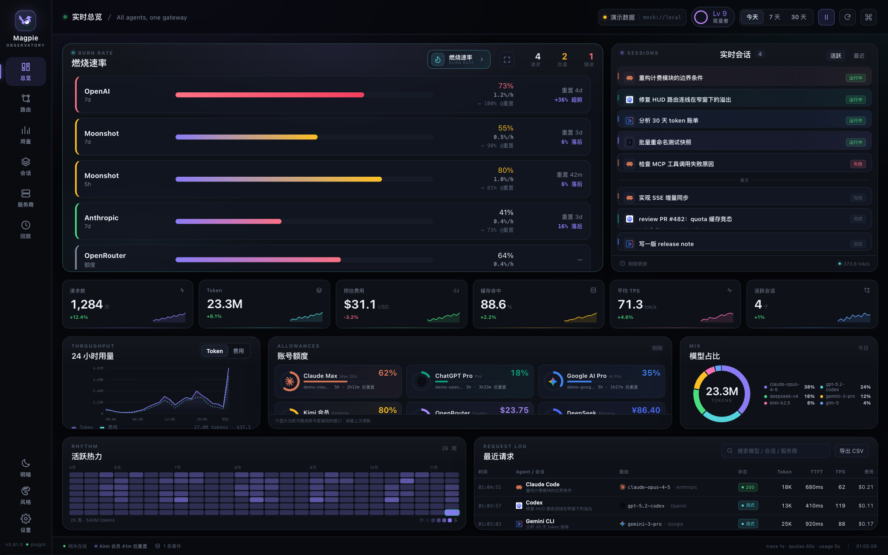
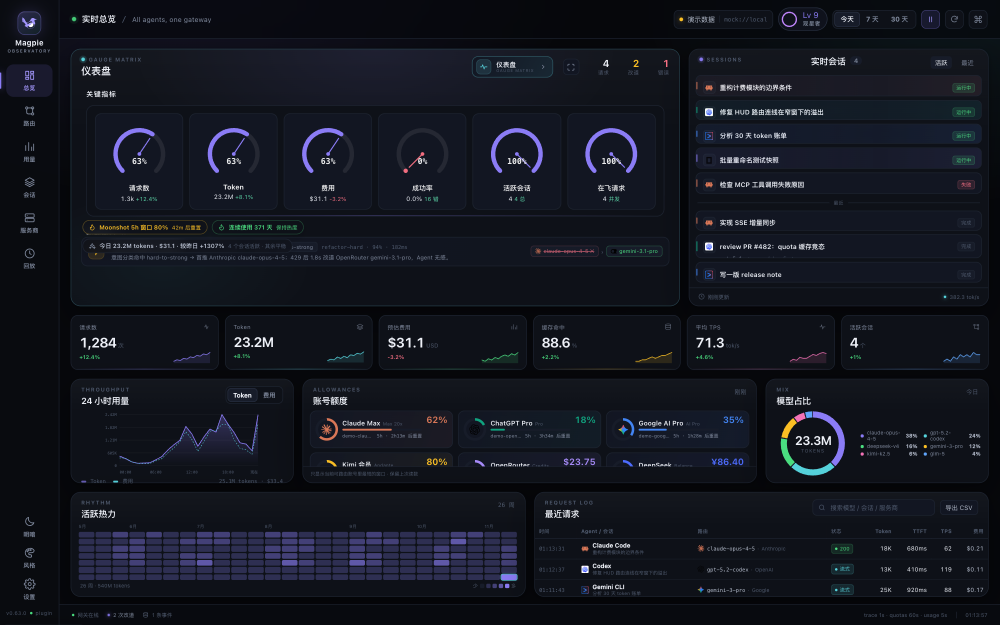
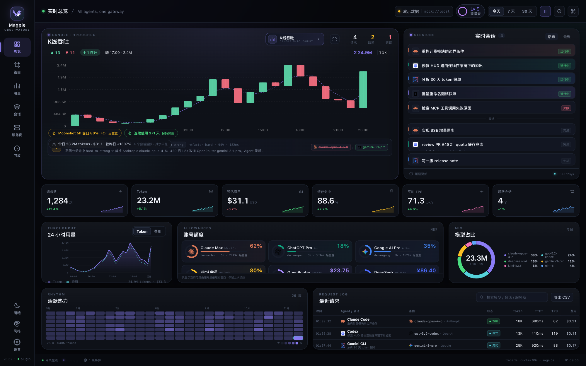
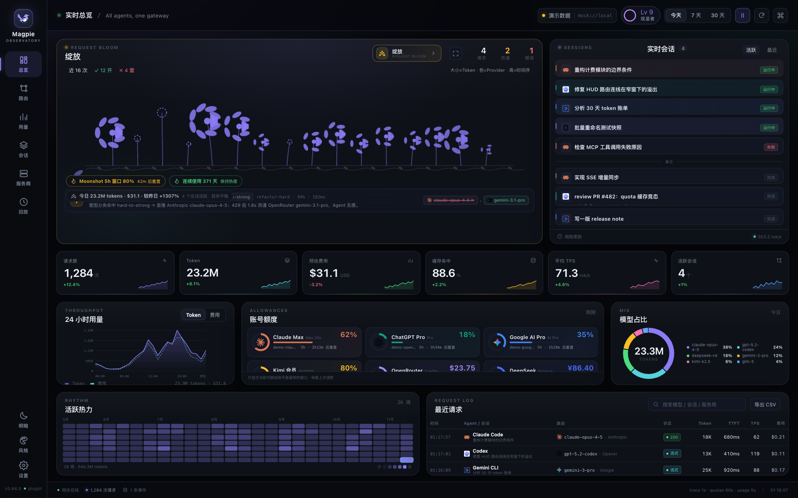
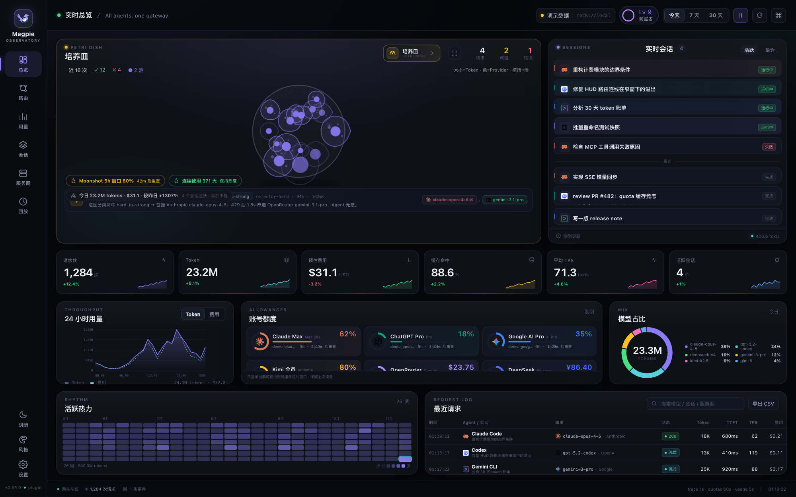
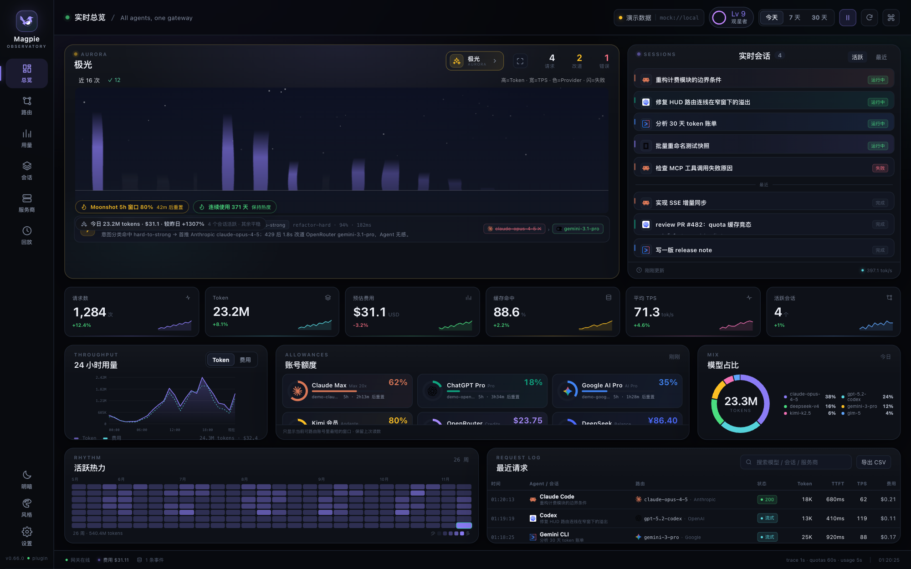
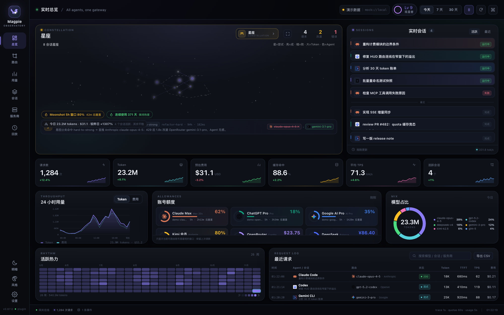

# Views · 30 种视图

One routing feed, thirty ways to look at it. `V` opens the picker, `G` tours,
`F` favourites, `O` cinemas. Screenshots live beside this file as
`mode-*.png`; `docs/interactions.md` maps every surface's controls.

## 实时 · Live

| View | What it is |
| --- | --- |
| **route** `LIVE ROUTING` | The default. Magpies fly the whole `Agent → Magpie → Provider` path; failures stay visible. |
| **waterfall** `SESSION WATERFALL` | Sessions as Gantt rows — pale first-token + streaming segment, click to focus. |
| **network** `RELATION GRAPH` | Force-directed `agent → provider → model` graph; node size = tokens. |
| **swarm** `LATENCY SWARM` | Per-provider TTFT points with P50/P90 lines; dot size = tokens. |
| **burn** `BURN RATE` | Every quota window's pace bar + sparkline + flat-pace ghost; `↑↓/Enter/Esc` + CSV. |
| **gauge** `GAUGE MATRIX` | KPI and quota-window 270° dials; quota dial click → `burn`. |

## 用量 · Usage

| View | What it is |
| --- | --- |
| **rings** `YEAR IN RINGS` | The last 26 weeks as a polar calendar — seven weekday rings, one column per week. |
| **latency** `LATENCY HEATMAP` | Time × latency-bucket heatmap, accumulates while open. |
| **stream** `STREAMGRAPH` | Provider token deltas over buffered snapshots; Horizon toggle. |
| **quota** `QUOTA PACE` | Each account's window as a burn-down line with projected left at reset. |
| **budget** `BUDGET BULLETS` | Bullet chart per window — 70/88 thresholds, pace marker, projected end. |
| **candle** `CANDLE THROUGHPUT` | OHLC candles per period — `←→/Enter/Esc` walk, crosshair + OHLC card. |

## 结构 · Structure

| View | What it is |
| --- | --- |
| **treemap** `COST TREEMAP` | Provider → model area by tokens; click to drill. |
| **marimekko** `MARIMEKKO` | Column width = provider share, band height = model share. |
| **sankey** `ROUTING FLOW` | `agent → provider → model` flow; link width = tokens. |
| **chord** `CHORD` | Agents on one arc, providers on the other; ribbon area = tokens. |
| **funnel** `REQUEST FUNNEL` | Calls → uncanceled → first token → success, with drop-offs. |

## 趣味 · Ambient

| View | What it is |
| --- | --- |
| **radar** `RADAR SCAN` | Providers on a dial, quota rings, in-flight sessions on the left. |
| **loom** `REQUEST LOOM` | Requests woven into coloured bands; the shuttle moves down. |
| **rhythm** `RHYTHM` | Requests land on a 16-step grid, a playhead sweeps. |
| **orrery** `ORRERY` | Providers as planets, moons = active sessions, arc = quota. |
| **chips** `COMBO CHIPS` | Each request a card; consecutive successes build a combo. |
| **factory** `REQUEST FACTORY` | Sessions as parcels through queued → streaming → done. |
| **bees** `BEEHIVE` | Providers as hives, sessions as bees; subagents smaller. |
| **stellar** `STELLAR DRIFT` | Providers as stars, requests as meteors; cinema-mode ambient. |
| **play** `PLAY` | Westworld dial — every request a beat; PERFECT/GREAT/MISS + combo. |
| **bloom** `REQUEST BLOOM` | Requests unfurl as flowers; failures are buds that never open. |
| **petri** `PETRI DISH` | Requests as living cells — cytoplasm = provider, nucleus pulses. |
| **aurora** `AURORA` | Requests as light-curtains; height = tokens, width = tps. |
| **constellation** `CONSTELLATION` | Sessions as star-patterns — one star per try, linked into a map. |

## Screenshots

| | | |
| --- | --- | --- |
|  |  |  |
|  |  |  |
|  |  | |
