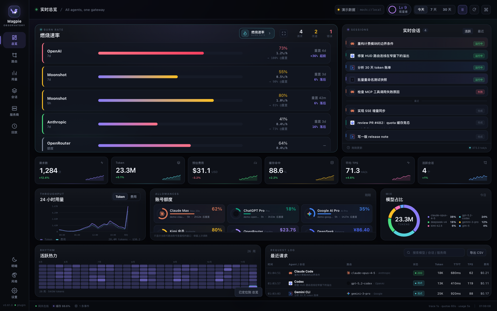
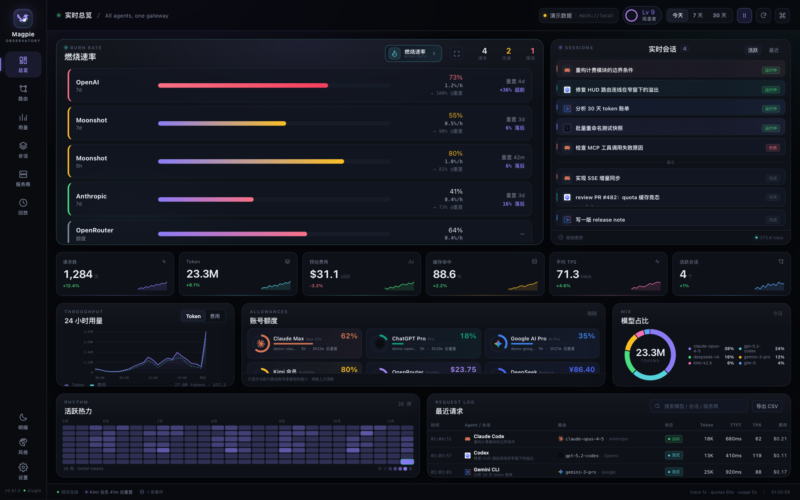
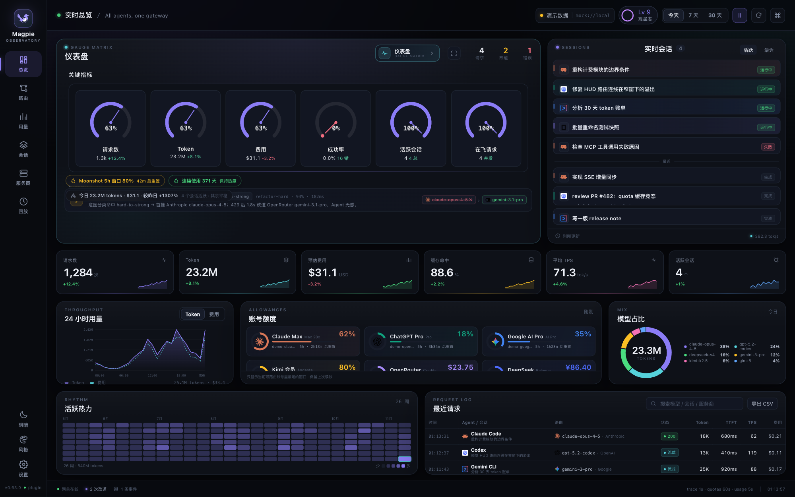
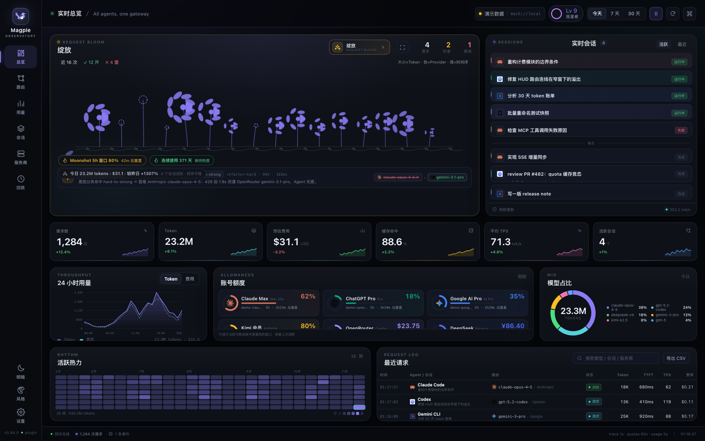
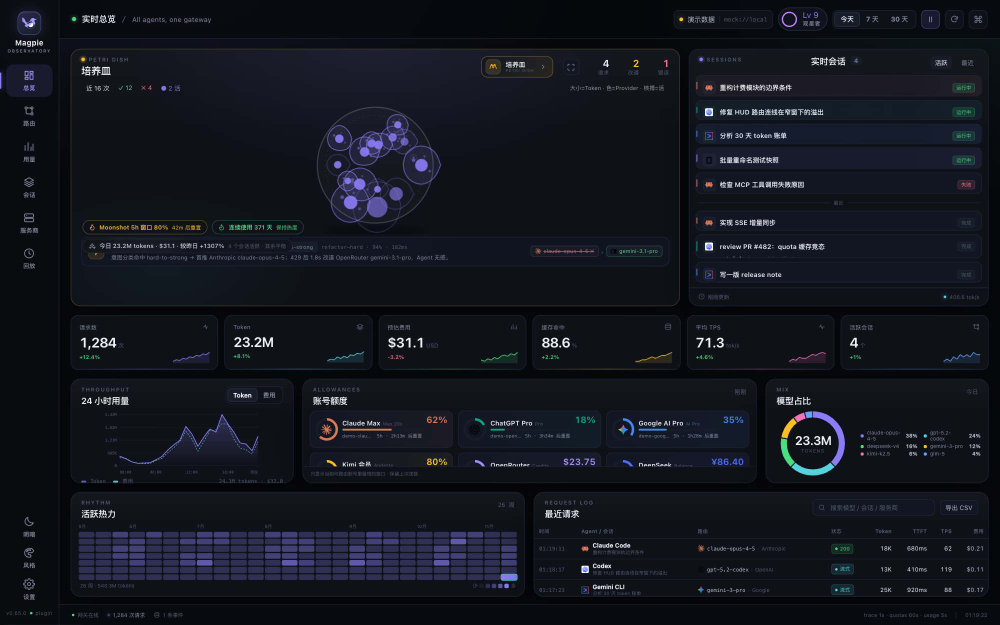
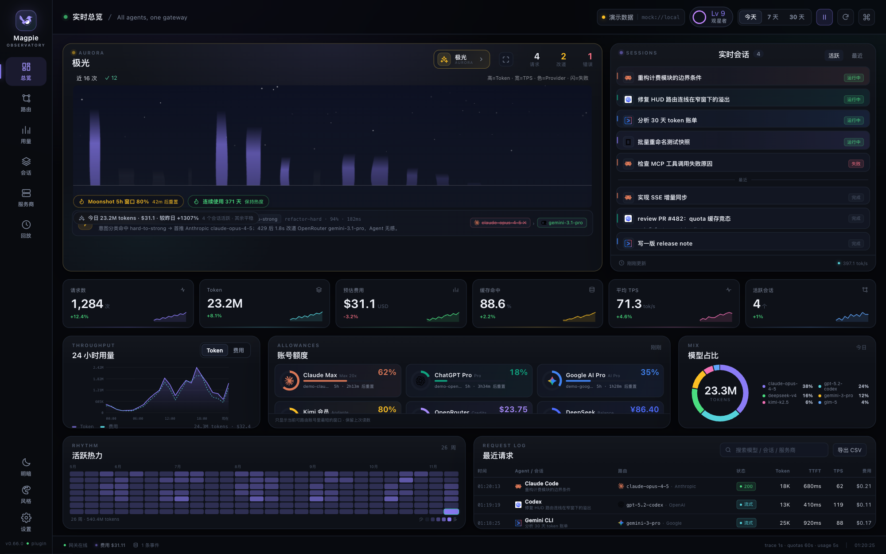
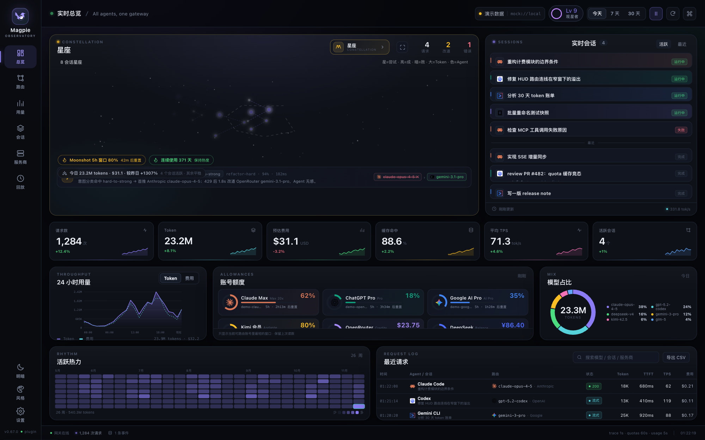

# 30 种视图

一份路由数据，三十种看法。`V` 开选择器、`G` 巡游、`F` 收藏、`O` 影院。
截图在同目录 `mode-*.png`；`docs/interactions.md` 是全交互清单。

## 实时 · Live

| 视图 | 是什么 |
| --- | --- |
| **路由** `LIVE ROUTING` | 默认。喜鹊沿 `Agent → Magpie → Provider` 全程飞；失败留痕。 |
| **瀑布** `SESSION WATERFALL` | 会话甘特——浅色首字 + 深色流式段，点击聚焦。 |
| **网络** `RELATION GRAPH` | `agent → provider → model` 力导向图；节点大小 = Token。 |
| **蜂群** `LATENCY SWARM` | 各 Provider TTFT 点带 P50/P90 线；点大小 = Token。 |
| **燃烧** `BURN RATE` | 每配额窗口的配速 bar + sparkline + 平速虚线；`↑↓/Enter/Esc` + CSV。 |
| **仪表盘** `GAUGE MATRIX` | KPI 与配额窗口 270° 表盘；配额表点击 → `burn`。 |

## 用量 · Usage

| 视图 | 是什么 |
| --- | --- |
| **年轮** `YEAR IN RINGS` | 最近 26 周极坐标日历——7 圈工作日、一列一周。 |
| **热力** `LATENCY HEATMAP` | 时间 × 延迟区间热力图，开着就累积。 |
| **河流** `STREAMGRAPH` | Provider Token 增量的 streamgraph；Horizon 切换。 |
| **额度** `QUOTA PACE` | 每账号窗口燃尽线 + 期末外推；绿/黄/红三档。 |
| **预算** `BUDGET BULLETS` | 每窗口 bullet——70/88 阈值、配速标记、期末外推。 |
| **K线** `CANDLE THROUGHPUT` | 每时段一根蜡烛——`←→/Enter/Esc` 走、crosshair + OHLC 卡。 |

## 结构 · Structure

| 视图 | 是什么 |
| --- | --- |
| **成本** `COST TREEMAP` | Provider → 模型的 Token 面积树图；点击下钻。 |
| **结构** `MARIMEKKO` | 列宽 = Provider 占比、带高 = 模型占比。 |
| **流向** `ROUTING FLOW` | `agent → provider → model` 流向；带宽 = Token。 |
| **和弦** `CHORD` | Agent 左弧、Provider 右弧；彩带面积 = Token。 |
| **漏斗** `REQUEST FUNNEL` | 发出 → 未取消 → 首字 → 成功，带流失量。 |

## 趣味 · Ambient

| 视图 | 是什么 |
| --- | --- |
| **雷达** `RADAR SCAN` | Provider 在环上、额度圈在周围、左边在飞会话。 |
| **织机** `REQUEST LOOM` | 请求织成彩带，梭子向下移动。 |
| **节奏** `RHYTHM` | 请求落 16 步格，播放头扫过。 |
| **星图** `ORRERY` | Provider 是行星、卫星 = 活跃会话、弧 = 额度。 |
| **连击** `COMBO CHIPS` | 每请求一张卡，连续成功攒 combo。 |
| **工厂** `REQUEST FACTORY` | 会话作包裹过 排队 → 流式 → 完成。 |
| **蜂巢** `BEEHIVE` | Provider 是蜂巢、会话是蜜蜂，子 Agent 更小。 |
| **夜航** `STELLAR DRIFT` | Provider 是星、请求是流星；影院氛围首选。 |
| **博弈** `PLAY` | Westworld 转盘，每次请求一拍；PERFECT/GREAT/MISS + 连击。 |
| **绽放** `REQUEST BLOOM` | 请求开成花；失败是永不开的花蕾，地面爬藤。 |
| **培养皿** `PETRI DISH` | 请求是活细胞——胞质 = Provider、核搏动、活细胞呼吸。 |
| **极光** `AURORA` | 请求是天空光带——高 = Token、宽 = TPS。 |
| **星座** `CONSTELLATION` | 会话是星图——每次尝试一颗星，连成更大星座。 |

## 截图

| | | |
| --- | --- | --- |
|  |  |  |
|  |  |  |
|  |  | |
